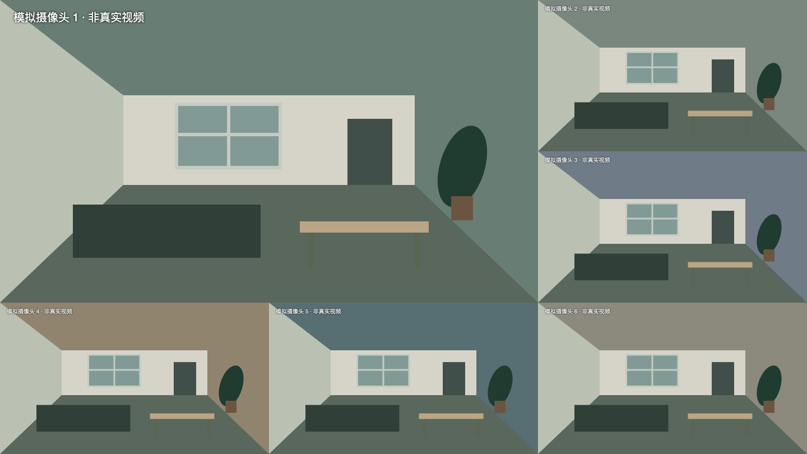
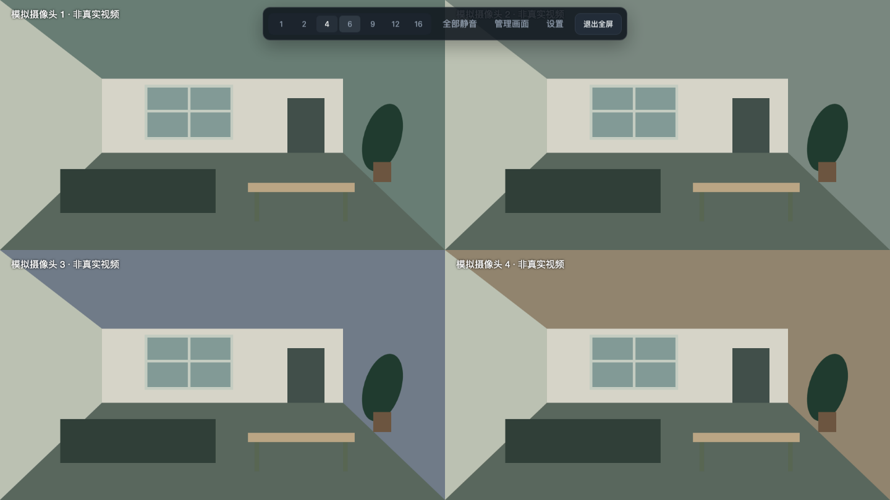

# Mi Camera Desktop

简单易用的小米摄像头客户端，支持 Windows 10/11 x64、macOS Apple 芯片及 Intel。安装包自带 go2rtc、Chromium 和 FFmpeg，安装后不需要配置服务或另外下载播放器。

下载：[0.1.2 试用版](https://github.com/Ray8876/xiaomi-camera-desktop/releases/tag/v0.1.2)。包含 Windows x64、Mac Apple 芯片和 Intel 安装包。0.1.0 Mac 签名不完整，请使用新版；0.1.2 真实摄像头和首次安装仍需实机验收。

## 网络前提

**电脑与摄像头必须位于可直接互通的局域网。当前客户端不提供米家 App 的外网云端中继播放。**

- 使用手机热点、公司网络等其他网络，不能直接访问摄像头所在家庭局域网时，无法播放；登录成功或设备列表可见不代表视频可达。
- 同一个 Wi-Fi 名称或相同 IP 网段不能证明互通。访客网络、AP 隔离、VLAN 或防火墙也可能阻止连接。不要仅凭 ping 或网段判断摄像头在线。
- 小米登录、获取设备及每次连接所需的加密密钥仍需要联网访问小米服务；有登录缓存也不是完全离线播放。
- 不可达时画面会提示连接中断并重试，不会自动改为云端中继。请先检查网络，再导出诊断日志。
- 已补充本地无响应设备的协议超时与界面重连回归；真实摄像头跨网测试仍待实机验收。

## 使用

1. 安装并打开客户端，用米家 App 的账号和地区登录，按提示完成图形或短信/邮箱验证码。
2. 首次登录自动发现摄像头并填入画面。通过“管理画面”安排摄像头。
3. 选择 1、2、4、6、9、12、16 格，6 格为 1 大 5 小。每路工具栏默认隐藏，鼠标移动时浮现在画面底部，停止操作约 2.4 秒后收起；可切换清晰度、声音、重连或放大，不占用视频高度。双击放大，Esc 收回，F11 全屏。
4. 全屏只保留视频区域，无边距、格间缝隙和常驻侧栏。4 格四等分，6 格第一路占左上 2×2 区域，其余五路排列在右侧及底部。鼠标移到屏幕顶部可临时显示布局、静音、画面管理、设置及退出全屏。
5. 在设置里选择开机自启、启动全屏、记住声音状态和显示方式。

登录会话、设备名称及源地址通过 Windows 系统加密 / macOS Keychain 支持的 Electron safeStorage 加密存储；密码不保存。以后打开恢复画面和布局，首次使用默认静音。关闭“记住声音状态”后，每次重启恢复静音。切换为较少格数保留其他格子的选择，只播放当前可见的格子。






小米登录会话被服务器撤销或失效时，需要重新登录。登录缓存无法读取时，启动界面可选择退出，或先备份加密缓存再重新登录，布局和声音设置会保留。备份不进入诊断日志包。刷新失败时保留已保存的画面，不清除缓存。首次导入可以选择已有的 go2rtc YAML 文件，仅提取小米登录，不修改原文件或原有服务。

## 日志

设置 → 导出日志。日志按 UTC 日期记录，保留当前日及之前 29 日，启动和每小时清理；每天最多 10 MiB。诊断 ZIP 包含版本、系统架构、摄像头数量、布局、脱敏连接/解码/重连记录，不包含登录缓存、密码、配置、设备名称、地址或密钥。诊断会保留编码类型、异常包序号和长度等分析信息，设备地址仍会过滤。导出失败可重试，重复导出会排队，失败临时文件会清理。发生问题时先导出日志，再说明发生时间和对应画面格号。

## 播放与系统要求

- 最多支持同时显示 16 路，实际帧率受电脑性能、网络、摄像头码率和小米连接限制影响。
- 自动模式优先直接播放。解码不支持时尝试兼容转码，也可手动选“兼容”。多路兼容转码会增加 CPU 使用率。
- 地区默认中国大陆，摄像头和电脑应能直接连接。小米通信及播放不通过环境代理。
- 退出客户端会结束其播放引擎和转码子进程。
- macOS 需 12 Monterey 或更新版本。安装包未配置 Apple Developer ID 公证及 Windows 代码签名。Mac 0.1.2 已补齐 ad-hoc 签名，首次打开方法见 [Mac 首次运行](docs/MAC-FIRST-RUN.md)。0.1.0 Mac 签名不完整，请使用新版。

## 开发与打包

需要 Node.js 22、pnpm 10、Go 1.25（构建时联网，运行时自带依赖）。

```sh
pnpm install --frozen-lockfile
pnpm test
pnpm run engine
pnpm run ffmpeg
pnpm start
pnpm build --mac --arm64
```

Windows 上使用 `pnpm build --win --x64`。Intel Mac 用 `--mac --x64`。`TARGET_PLATFORM=win32|darwin` 和 `TARGET_ARCH=x64|arm64` 可指定引擎/FFmpeg目标。为节约 Actions 配额，普通 main 提交不自动打包；仅手动运行工作流或发布版本 tag 时测试和构建安装包。

完整 go2rtc 源码、补丁和许可证见 `engine/`。FFmpeg 校验值固定在构建脚本中。项目不包含真实账号、设备、生产配置或用户日志。

## 验收边界

界面及模拟流程测试、打包验证不能代替真实摄像头验收。用户已反馈 Windows 客户端测试正常；该反馈未逐项确认 16 路长期负载、自启或跨网等所有边界。现有 go2rtc 保持原样。详见 `docs/ACCEPTANCE.md`。

## 开源与许可证

客户端原创代码使用 [MIT](LICENSE)；go2rtc 及 VideoRTC 保留 Alexey Khit 的 MIT 版权声明。FFmpeg 为单独调用的 GPLv3 程序，许可证不因本项目使用 MIT 而改变。完整说明见 [第三方声明](THIRD_PARTY_NOTICES.md)、[源码及构建说明](docs/FFMPEG-SOURCE.md) 和 [依赖许可证](licenses/README.md)。

本项目是独立客户端，与小米没有关联，不承诺所有型号兼容。参与开发见 [CONTRIBUTING](CONTRIBUTING.md)，安全问题请按 [SECURITY](SECURITY.md) 私下报告；请勿在公开 Issue 上传账号、会话缓存或未脱敏日志。

当前代码完善情况及更新记录见 [CHANGELOG](CHANGELOG.md)，待实机确认的事项见 [验收清单](docs/ACCEPTANCE.md)。
