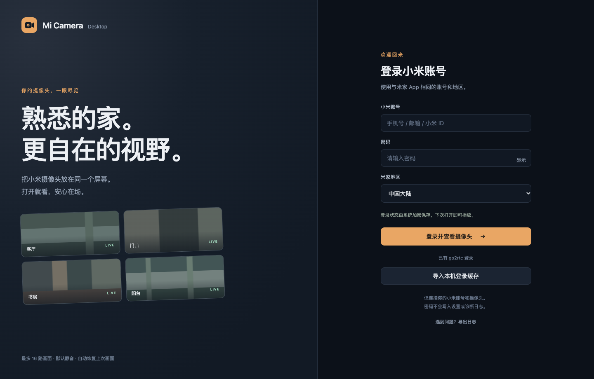
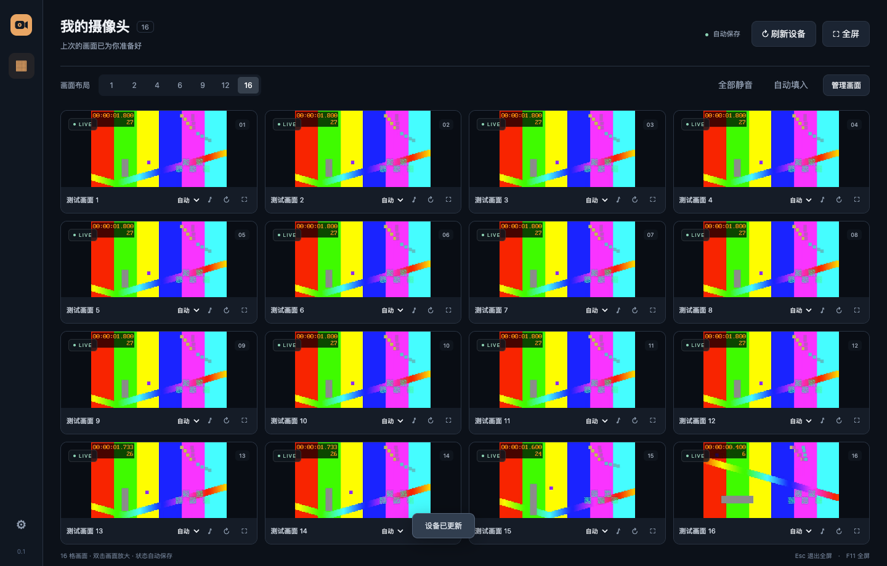

# Mi Camera Desktop

简单易用的小米摄像头客户端，支持 Windows 10/11 x64、macOS Apple 芯片及 Intel。安装包自带 go2rtc、Chromium 和 FFmpeg，安装后不需要配置服务或另外下载播放器。

下载：[Windows 安装程序](https://github.com/Ray8876/xiaomi-camera-desktop/releases/download/v0.1.0/Mi-Camera-Desktop-0.1.0-win-x64.exe) · [Apple 芯片 Mac](https://github.com/Ray8876/xiaomi-camera-desktop/releases/download/v0.1.0/Mi-Camera-Desktop-0.1.0-mac-arm64.dmg) · [Intel Mac](https://github.com/Ray8876/xiaomi-camera-desktop/releases/download/v0.1.0/Mi-Camera-Desktop-0.1.0-mac-x64.dmg)。校验文件及说明见 [0.1.0 预发布页](https://github.com/Ray8876/xiaomi-camera-desktop/releases/tag/v0.1.0)。

## 使用

1. 安装并打开客户端，用米家 App 的账号和地区登录，按提示完成图形或短信/邮箱验证码。
2. 首次登录自动发现摄像头并填入画面。通过“管理画面”安排摄像头。
3. 选择 1、2、4、6、9、12、16 格。单格切换清晰度、开关声音、重连或放大；双击放大，Esc 收回，F11 全屏。
4. 在设置里选择开机自启、启动全屏、记住声音状态和显示方式。

登录会话、设备名称及源地址通过 Windows 系统加密 / macOS Keychain 支持的 Electron safeStorage 加密存储；密码不保存。以后打开恢复画面和布局，首次使用默认静音。关闭“记住声音状态”后，每次重启恢复静音。切换为较少格数保留其他格子的选择，只播放当前可见的格子。





小米登录会话被服务器撤销或失效时，需要重新登录。刷新失败时保留已保存的画面，不清除缓存。首次导入可以选择已有的 go2rtc YAML 文件，仅提取小米登录，不修改原文件或原有服务。

## 日志

设置 → 导出日志。日志按 UTC 日期记录，保留当前日及之前 29 日，启动和每小时清理；每天最多 10 MiB。诊断 ZIP 包含版本、系统架构、摄像头数量、布局、脱敏连接/解码/重连记录，不包含登录缓存、密码、配置、设备名称、地址或密钥。发生问题时先导出日志，再说明发生时间和对应画面格号。

## 播放与系统要求

- 最多支持同时显示 16 路，实际帧率受电脑性能、网络、摄像头码率和小米连接限制影响。
- 自动模式优先直接播放。解码不支持时尝试兼容转码，也可手动选“兼容”。多路兼容转码会增加 CPU 使用率。
- 地区默认中国大陆，摄像头和电脑应能直接连接。小米通信及播放不通过环境代理。
- 退出客户端会结束其播放引擎和转码子进程。
- macOS 需 12 Monterey 或更新版本。初版尚未配置 Apple Developer ID 公证及 Windows 代码签名，下载后系统可能提示未识别的开发者。

## 开发与打包

需要 Node.js 22、pnpm 10、Go 1.25（构建时联网，运行时自带依赖）。

```sh
pnpm install --frozen-lockfile
pnpm test
pnpm run engine
pnpm run ffmpeg
pnpm start
pnpm build --mac --arm64
```

Windows 上使用 `pnpm build --win --x64`。Intel Mac 用 `--mac --x64`。`TARGET_PLATFORM=win32|darwin` 和 `TARGET_ARCH=x64|arm64` 可指定引擎/FFmpeg目标。GitHub Actions 自动测试并构建三个系统架构的安装包。发布 tag 后生成含 SHA-256 的预发布版本。

完整 go2rtc 源码、补丁和许可证见 `engine/`。FFmpeg 校验值固定在构建脚本中。项目不包含真实账号、设备、生产配置或用户日志。

## 验收边界

界面及模拟流程测试、打包验证不能代替真实摄像头验收。Windows 主机已上线，可先安装客户端试用；原有会话导入、小米实机登录、H.265/声音、16 路负载及登录后自启仍待验收。现有 go2rtc 保持原样。详见 `docs/ACCEPTANCE.md`。
